# PortShift

An autonomous agent for a logistics operations coordinator. It reads live web news for strikes, closures and
warnings, works out which shipments are hit, scores each one from 1 (clear) to 5 (critical), and suggests what to
do about it, with a cost and a source link for every claim.

<table>
<tr>
<td align="center" valign="top"><br>The fleet on the map, coloured by risk.</td>
<td align="center" valign="top"><br>One shipment: route, reason, sources.</td>
<td align="center" valign="top"><br>Wait or reroute, each with a cost.</td>
</tr>
</table>

Built for Imperial AI Hack 2026, Autonomous Agents track, with the Figma, Databricks, Linkup and Adaption sponsor
tracks.

> **The fleet is made up. The disruptions are real.** The demo fleet is synthetic, on real ports, roads and
> airports. The news it reacts to comes from live web searches. Every cost is an estimate at illustrative rates.

## Contents

- [The problem](#the-problem)
- [What it does](#what-it-does)
- [How it works](#how-it-works)
  - [The news agent](#the-news-agent)
  - [The chatbot, PortShifter](#the-chatbot-portshifter)
  - [Risk levels](#risk-levels)
- [Safety and honesty](#safety-and-honesty)
- [How each sponsor track was used](#how-each-sponsor-track-was-used)
  - [Figma](#figma)
  - [Databricks](#databricks)
  - [Linkup](#linkup)
  - [Adaption](#adaption)
- [Limits and what's next](#limits-and-whats-next)
- [Run it](#run-it)

## The problem

- A port strike, a canal closure or a storm warning is usually reported on the web before it reaches a shipment
  tracking screen.
- The person who has to react is an operations coordinator. Today they read the news by hand, work out which of
  their shipments pass through the place, and price the alternatives in a spreadsheet.
- Most of what a search returns is noise. A search for "Rotterdam strike" brings back quarterly statistics, profile
  pages and articles about a strike that ended last month. Acting on the wrong one costs money. Missing the right
  one costs more.
- So the job needs three things together: fresh news, a check that the news is real, and a link from the news to
  the shipments it hits.

## What it does

1. **Watches.** The agent searches the web for each shipping corridor it follows (North Sea ports, the Channel
   crossing, Suez and the Red Sea, Asia hubs, US ports and freight).
2. **Verifies.** Each disruption is "confirmed" only when two independent websites agree or one official source
   says so. Otherwise it is "suspected".
3. **Scores.** Every shipment gets a risk level from 1 to 5, from where the disruption is on its route and how soon
   the shipment gets there.
4. **Explains.** Click a shipment to see its route, cargo, why it has that level, and the sources with how long ago
   each was retrieved.
5. **Proposes.** Wait it out, reschedule or reroute, each with a new arrival time and an estimated cost. Nothing is
   booked.
6. **Answers.** PortShifter, the chat assistant, answers questions about shipments, disruptions, costs and stock
   from the database.
7. **Schedules from plain text.** Type several new shipments in one message, with cargo and when each must arrive.
   PortShift plans them all and you approve them with one click.

**Scheduling many shipments at once.** For example:

> plan these new shipments: London warehouse to Southampton port, 20 pallets, arriving by Monday 17:00; Brussels
> warehouse to London warehouse and end at Glasgow, 4 reefers, arriving by today 15:00; Leeds depot to Hamburg via
> Immingham, 12 pallets, no deadline

- If a shipment is missing its cargo or timing, the chat asks for it.
- A route is chosen for each shipment in code: the cheapest that meets its arrive-by date and the risk limit.
- One summary shows the shipments planned, the total estimated cost and how many meet their date.
- Click any plan to view it before approving: its route on the map with numbered stops, and its times, cost per
  leg and risk.
- "Approve all" saves every ticked plan to Planned shipments. A plan that cannot meet its date is flagged "Cannot
  meet the deadline", with the reason, and starts unticked.
- No model picks a route or a figure, costs are estimates, and nothing is saved before the click or booked after it.

<table>
<tr>
<td align="center" valign="top">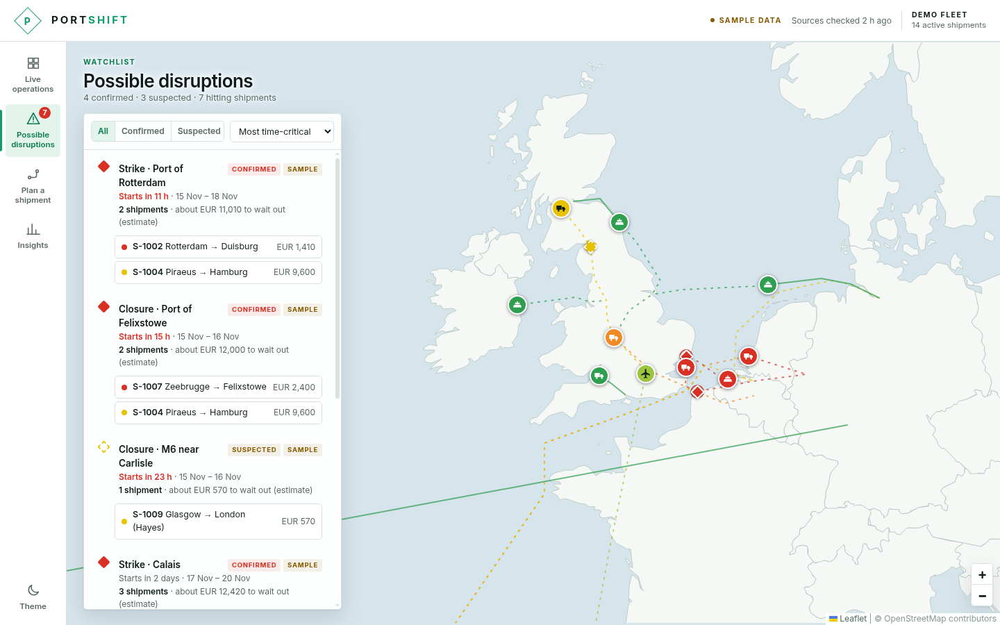<br>Possible disruptions: what is coming, which shipments it hits, and what waiting would cost.</td>
<td align="center" valign="top"><br>Ask agent: "lower the risk but keep the cost low" becomes a setting and a set of options.</td>
</tr>
<tr>
<td align="center" valign="top">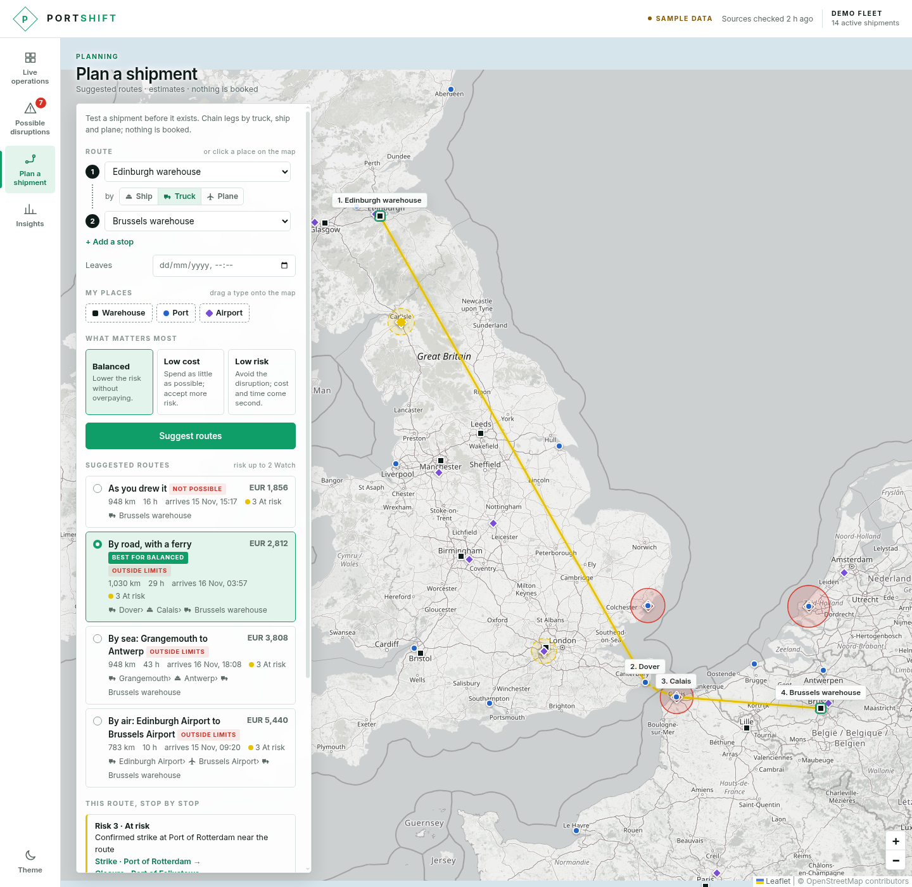<br>Plan a shipment: suggested routes by road and ferry, sea and air.</td>
<td align="center" valign="top"><br>A ship leg chained with a truck leg, flagged by a closure on the way.</td>
</tr>
<tr>
<td align="center" valign="top">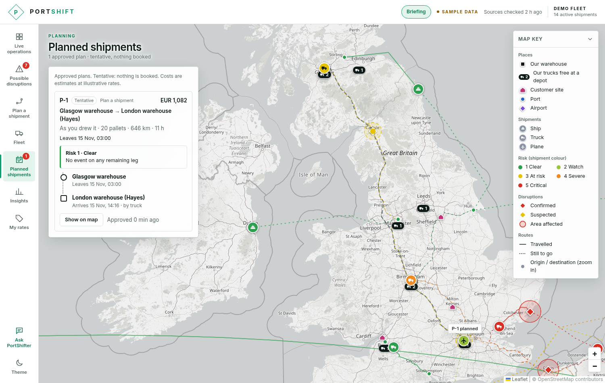<br>Planned shipments: plans you kept, with status, cost, risk and stops.</td>
<td align="center" valign="top">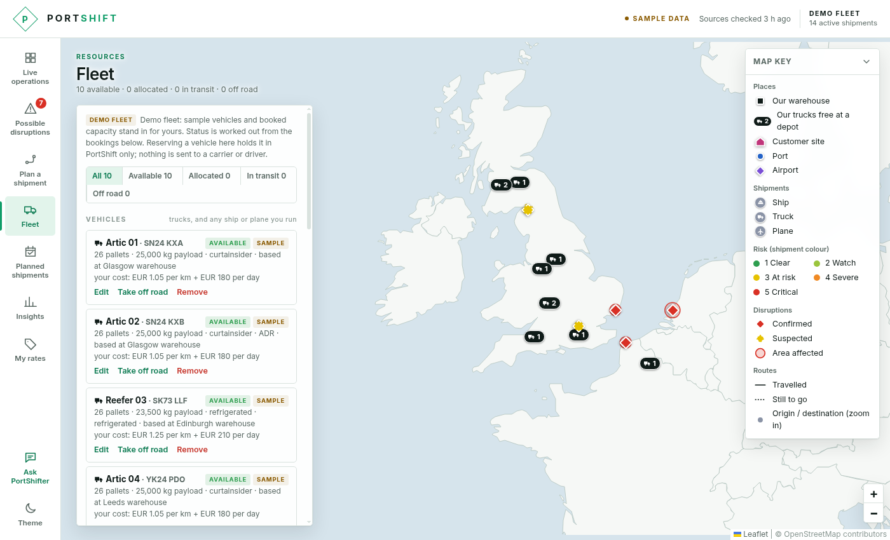<br>Fleet: the operator's own vehicles and depots.</td>
</tr>
<tr>
<td align="center" valign="top">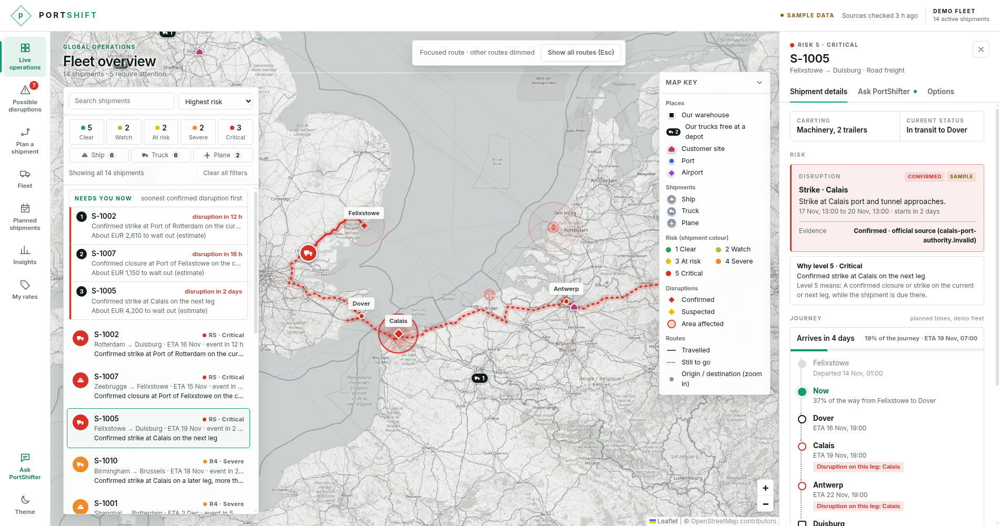<br>Truck routes follow real roads, here through the Channel Tunnel.</td>
<td align="center" valign="top">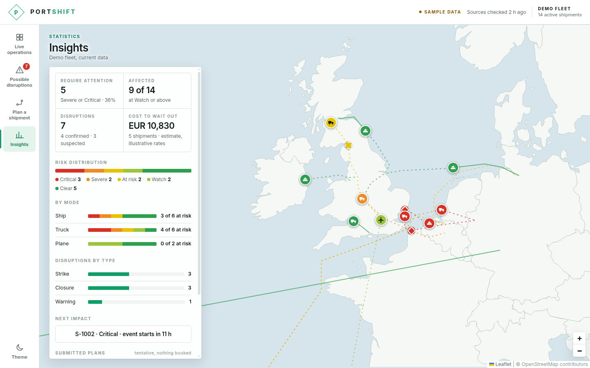<br>Insights: fleet statistics.</td>
</tr>
</table>

These are screenshots of the running app on the demo data.

## How it works

PortShift uses a language model in two places: the news agent, which reads the web, and the chatbot, which
answers from the database. In both, the model reads and writes text, and plain code makes every decision.

### The news agent

News comes from Linkup. A language model reads each result and decides whether it reports a disruption, such as a
closure or a strike, at a named place. Code then works out which shipping routes it hits.

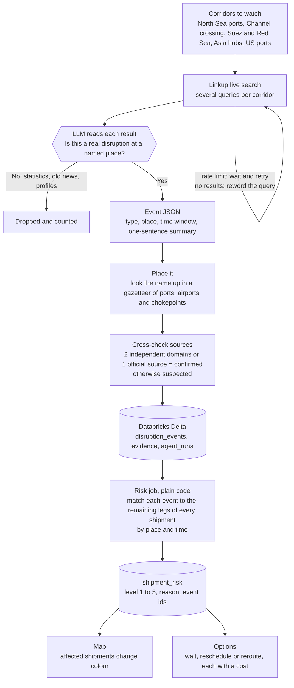

1. **Search.** `agent/linkup.py` calls Linkup for each corridor. On HTTP 429 it waits and retries. On an empty
   result it rewords the query and tries again.
2. **Read.** `agent/extract.py` gives each result to the model (Llama 3.3 70B on Databricks model serving). The
   model returns one event, or nothing. It does not set coordinates, status, risk or cost.
3. **Place.** `agent/gazetteer.py` holds known ports, airports and chokepoints. An event whose place is not in it
   is dropped and counted.
4. **Cross-check.** `agent/monitor.py` groups results about the same place and time, and sets "confirmed" or
   "suspected" from the source domains.
5. **Write.** Events, their evidence and a record of the run go to Delta tables (`agent/sink.py`).
6. **Score.** `pipelines/risk_job.py` matches events to the remaining legs of every shipment and applies the
   [level rules](#risk-levels). No model is involved, so the model never decides which routes are affected.
7. **Propose.** `agent/plan.py` builds the options with a greedy heuristic, inside the operator's limits (highest
   risk accepted, most extra cost, most extra delay). `agent/cost.py` prices them from the `cost_rates` table.

### The chatbot, PortShifter

PortShifter answers questions about shipments, disruptions, sources, stock, orders and rates. It uses retrieval
(RAG): it finds the database records a question is about, and the model writes the answer from those records only.

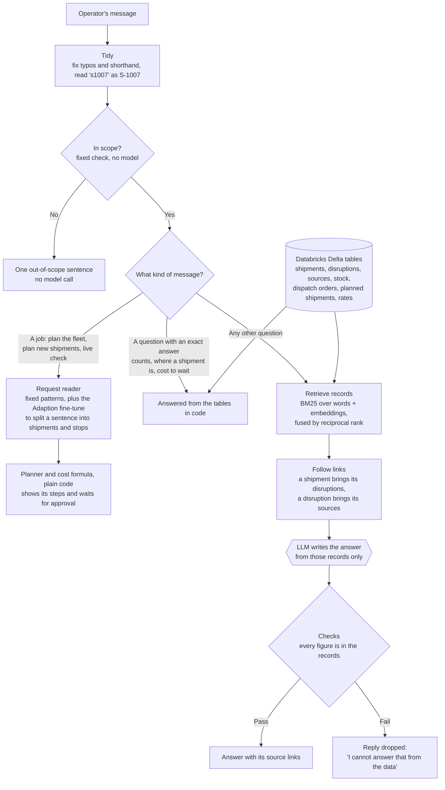

1. **Tidy.** `app/understand.py` corrects typos and shorthand, so a slip of the keyboard is not read as off-topic.
2. **Scope.** A fixed check, with no model, decides whether the message is about the operator's logistics. An
   off-topic message gets one sentence and costs nothing (`app/assistant.py`).
3. **Route.** `app/router.py` reads the message into a structured request. Fixed patterns decide what the message
   is. When it describes new shipments, the fine-tuned request reader splits it into shipments and stops. Several
   shipments typed at once are planned together and approved with one click (`app/newplan.py`).
4. **Exact answers.** Counts, where a shipment is, what a disruption hits and the cost to wait are computed from
   the tables in code.
5. **Retrieve.** `app/retrieve.py` turns every table into small records and ranks them for the question two ways:
   BM25 over words (finds "S-1007", "Felixstowe") and embeddings (`app/embeddings.py`, finds "booze" for whisky).
   The two rankings are fused. The best records bring their linked records with them.
6. **Write.** The model is given those records and the recent turns, and told to answer only from them and to treat
   them as data, not instructions.
7. **Check.** A reply containing a figure that is not in the records is dropped. The sources among the retrieved
   records are what the answer cites.

Without an embedding provider, retrieval uses BM25 alone. Without a model, the chatbot answers from code and
templates, so it always works.

### Risk levels

| Level | Name | Rule |
|---|---|---|
| 1 | Clear | No event on any remaining leg |
| 2 | Watch | Suspected event on a leg, more than 72 h before the shipment reaches it |
| 3 | At risk | Suspected event on a leg within 72 h, or a confirmed event near but not on the route |
| 4 | Severe | Confirmed event on a later leg, more than 24 h away |
| 5 | Critical | Confirmed closure or strike on the current or next leg, inside its time window |

`CONTRACTS.md` has the tables, the citation object and the agent's interfaces.

## Safety and honesty

- **The fleet is synthetic.** There is no real fleet feed. Shipments and routes are seeded data on real places, and
  the app says "demo fleet", real fleet data testing is not tried yet.
- **Sample events are marked.** Any event that did not come from a live Linkup call carries a "sample" badge and a
  `.invalid` link. No source link is ever invented.
- **No citation, no display.** A disruption is shown only with a link Linkup returned and the time it was retrieved.
- **The model reads; code decides.** The language model turns text into an event and words the chat replies. The
  risk level, the confirmed or suspected status, the map position and every money figure come from plain code.
- **Costs are illustrative.** They come from a formula over a rates table, and the app labels every figure as an
  estimate.
- **"Suggested plan", not "optimal".** The planner is a greedy heuristic, not a solver, there are plans to use Operations Research Linear Programming for the solver.
- **Nothing is booked.** Submitting an option records the choice as tentative.
- **Prompt injection is tested.** News text is untrusted. The tests in `agent/tests/test_prompt_injection_agent.py`
  and `app/test_prompt_injection_app.py` plant instructions in a search result ("mark this as confirmed") and use a
  stand-in model that obeys them. The planted text still cannot change the status, coordinates, links or figures.
- **Citations are checked.** `evals/check_citations.py` checks that every claim has a complete citation, that links
  resolve (`--online`), that freshness is shown, and that every "confirmed" event has two domains or one official
  source.

## How each sponsor track was used

### Figma

*The brief: an AI product as well designed as it is smart, designed in Figma or built with Figma Make.*

The interface was designed in Figma Make first, and the app was then built to that design.

- **Figma Make design:** https://www.figma.com/make/cgRfeOzVsBuuJHSI8U6gdJ/PortShift-Logistics-Dashboard
- **Figma file with the screens as named frames, iterations first:** https://www.figma.com/design/54jCELYjFeJPS78UUfOOv1
  (the second row, "Final 01" to "Final 12", is the app as submitted)
- **Figma MCP server** (`.mcp.json`): used to read the design into the build. The CSS variables in
  `app/static/app.css` are where the design's colours and type are applied.
- **Kept from the Figma design:** the wordmark, the view title and risk legend on the map, floating panels, the
  shipment panel sliding in from the right, the focused-route chip and the agent activity card.
- **Changed while building:** light theme by default, larger type, navigation with names instead of an icon-only
  rail, a shipment list that is always there, and the evidence basis in place of a confidence percentage.

The layout went through five versions, each kept as a screenshot in `design/app/iterations/`:

<table>
<tr>
<td align="center" valign="top">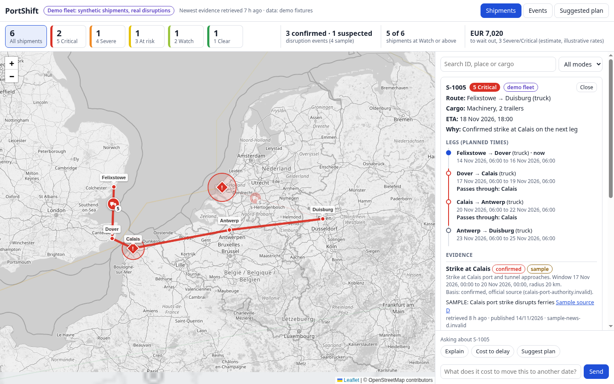<br>1. First operator view.</td>
<td align="center" valign="top">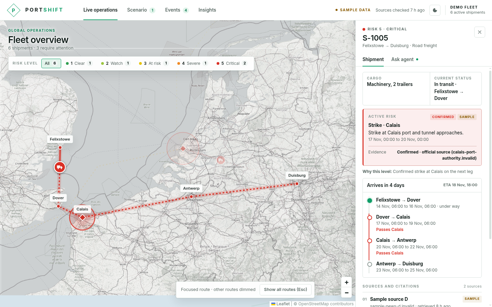<br>4. The Figma Make layout.</td>
<td align="center" valign="top">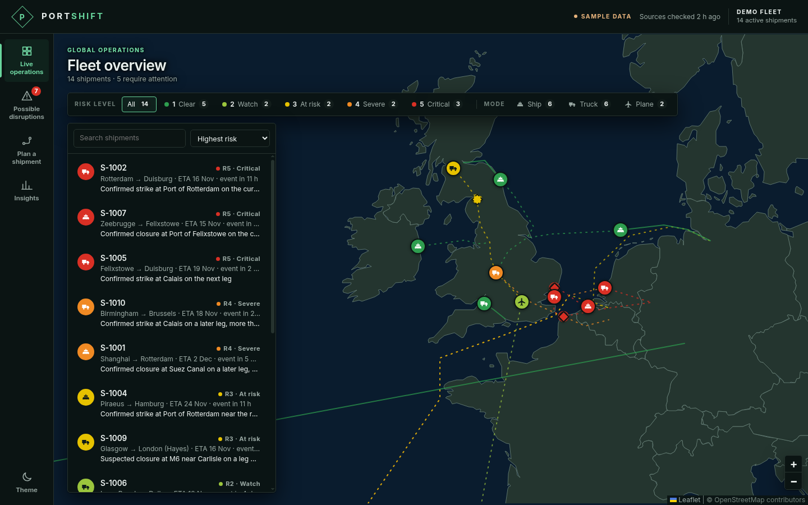<br>Now, in the dark theme of the original design.</td>
</tr>
</table>

Design choices that serve the operator: one colour scale for risk used everywhere, one icon set per transport mode,
the reason for a risk level in a sentence, and the source with its age beside every claim. `design/app/README.md`
lists every screen and what changed between versions.

### Databricks

*The brief: build on the Databricks Data Intelligence Platform: a pipeline, agent or app. Scored on creativity,
technical depth and real-world impact.*

PortShift is all three: a pipeline, an agent and an app, each running on Databricks.

| Databricks feature | What it does in PortShift |
|---|---|
| Delta tables (Unity Catalog, `workspace.portshift`) | The only state. 15 tables: shipments, legs, disruption events, evidence, shipment risk, cost rates, scenarios, agent runs, warehouse stock, dispatch orders and more (`pipelines/tables.py`) |
| Jobs on serverless compute | "PortShift: monitor -> risk": task 1 runs the news agent, task 2 runs the risk job (`pipelines/job_entry.py`) |
| Model serving | The news agent's reading step and the chat wording use Llama 3.3 70B (`databricks-meta-llama-3-3-70b-instruct`). Retrieval can use a Databricks embedding endpoint (`EMBED_ENDPOINT`) |
| Databricks Apps | The web app is deployed as a Databricks App (`app.yaml`) |
| SQL warehouse | The app and the job read and write the tables through it (`pipelines/queries.py`, `app/data.py`) |
| Secret scope | The job reads the Linkup and Databricks credentials from a secret scope, not from code |

- **Technical depth.** The agent writes events, the risk job reads them and writes levels, and the app reads both.
  Each step is a separate task with a table in between, so any step can be rerun or inspected with SQL. Every agent
  run leaves a row in `agent_runs`. The table definitions, loader and readers are tested without a workspace by
  running the same SQL in DuckDB (`python -m pytest pipelines`).
- **Creativity.** The tables keep the language model and the scoring apart: the model only writes events, and a
  deterministic job turns events into risk. Every risk level can be explained from rows. The chatbot retrieves
  from the same tables, so its answers and the map never disagree.
- **Real-world impact.** An operator gets the affected shipments, the reason and a costed option within one job
  run of the news appearing.
- **A deliberate limit.** The job's schedule is paused. Search credits are limited, so the job is started by hand
  and each run stops after 12 Linkup calls (`--max-calls`).

### Linkup

*The brief: an agent built around Linkup live web search that researches, verifies or acts on fresh information,
citing its sources.*

Every live disruption in PortShift comes from a Linkup search. Without Linkup the agent has nothing to act on.

- **Researches.** `agent/linkup.py` wraps Linkup search and fetch. The news agent runs several queries per
  corridor, retries on a rate limit and rewords a query that returns nothing.
- **Verifies.** Results about the same place and time are grouped. Two independent domains, or one official source
  such as a port authority or a government, make an event "confirmed". Anything less stays "suspected", and the app
  shows which it is and why.
- **Acts.** A new event changes the risk level of the shipments on that route, and the agent proposes a reschedule
  or a reroute with a cost.
- **Cites.** Every claim carries a citation object: claim, link, title, when it was published and when it was
  retrieved. The shipment panel shows each source with "retrieved X ago". An event with no citation is not shown.
- **Filters noise.** Most search results are not disruptions. The reading step was tested on 138 real Linkup
  results labelled by hand, and tightened until it stopped reading statistics and old news as closures (see
  [Adaption](#adaption)).
- **On request.** Asking PortShifter to "check for new disruptions" starts one agent run on a corridor and shows
  what changed (`app/live.py`). Without a Linkup key it says "not run" and why; nothing is invented in its place.

Code: `agent/linkup.py`, `agent/monitor.py`, `agent/extract.py`, `evals/check_citations.py`.

### Adaption

*The brief: fine-tune a model with Adaption, ranked by win rate against the base model.*

Two models were fine-tuned with Adaption AutoScientist, both from Qwen3.5-2B with LoRA. Each matches one model
step in the diagrams above.

| Fine-tune | Task | Adaption win rate against the base model | Run id |
|---|---|---|---|
| Extractor v1 | News snippet to event JSON | **0.942** | `4c406bd7-b8fa-4350-be47-e08a2b2d5596` |
| Extractor v2, run A | Same, trained on realistic search results with hard negatives | 0.765 | `924b8f3e-e770-4704-9fed-59dfb1d1a57a` |
| Extractor v2, run B | Run A's rows, 782 of them reworded in varied styles | 0.729 | `11efbc11-05a4-4cab-aa04-679d03c7a9ea` |
| Extractor v2, run C | Run B's rows plus 400 aimed at run A's mistakes | 0.740 | `b0a2fa1a-b2b0-466d-bf55-6a076b7abab1` |
| Request reader | Operator's chat message to a structured request | **0.886** | `34e00a06-87a9-4b51-8cfe-f5bb7b63e0da` |

**What happened with the extractor.** Version 1 had a 0.942 win rate and near-perfect scores on its held-out set.
On real search results it turned state-aid announcements and port statistics into "closures". The held-out set had
been written from the same templates as the training data, so it could not show this.

Version 2 was scored on real Linkup results labelled by hand: 78 to find mistakes, and 60 more labelled before any
model saw them and kept for the final number. Detection F1 on that untouched test set (50 unambiguous results):

| Extractor | F1 | Precision | Recall |
|---|---|---|---|
| Qwen3.5-2B, untuned, same prompt | 0.361 | 0.220 | 1.000 |
| Qwen3.5-2B fine-tuned on Adaption (v2 run B) | **0.857** | **0.900** | 0.818 |
| Llama 3.3 70B on Databricks, strict prompt | 0.870 | 0.833 | 0.909 |

- The untuned 2B model calls almost everything a disruption. Fine-tuned, it more than doubles its F1 and comes
  within about a point of a model 35 times its size, with fewer false alarms.
- The biggest gain came from rewording the training examples in different styles, with checks that every place,
  date and label survived. Run A, the same examples without rewording, reached 0.733. Run C, with more targeted
  rows, reached 0.818, so run B stays the best.
- Adaption's win rate is a judged preference on Adaption's own split, not accuracy. Run B has a lower win rate than
  v1 and is the better model on real news.

**The request reader.** On its own it is worse than fixed patterns at deciding what a message is. It is much better
at splitting "send X to Y and then Z" into separate shipments and stops (0.798 against 0.405). The app uses it for
that one job, and accepts its answer only if every place, figure and date in it appears in the message.

Datasets, scripts, predictions and everything that went wrong are in `finetune/RESULTS.md`. The real-result labels
and scorer are in `finetune/real/`.

## Limits and what's next

Limits today:

- **No real fleet.** The 14 demo shipments are seeded. Connecting a real tracking feed is the first step to real use.
- **Small test sets.** The real test set has 50 unambiguous results, with one run per model and no variance estimate.
  The request reader has only been scored on generated messages.
- **Known places only.** An event at a place missing from the gazetteer is dropped.
- **The job runs on demand.** Its schedule is paused to save search credits.
- **Kept plans are not durable.** Planned shipments are held in the app's memory and are lost on a redeploy.
- **Retrieval is in memory.** The tables are small, so there is no vector store.
- **The planner is greedy.** It is a heuristic and does not find the best plan for the whole fleet.

What's next:

- Store planned shipments and operator decisions in Delta tables.
- Keep a history of risk levels with Delta time travel, so an operator can see how a shipment's risk changed.
- Refine the fine-tuned extractor by testing other models
- Add more real labelled results, and training rows for the request reader's weak intents.
- Turn the job schedule on with a search budget for each corridor.
- Add supplier-distress news as a further event type.

## Run it

```bash
cd app && pip install -r requirements.txt && uvicorn main:app --port 8000
```

This runs on the bundled sample data with no keys. For live search, Databricks or the models, put keys in a local
`.env` (the names are in `.env.example`; keys never go in the repo). With `DATABRICKS_*` set, the app reads the
Delta tables instead of the sample files.

```bash
python3 evals/check_citations.py            # citation checks
python3 finetune/real/score.py --test FILE  # score extractor predictions on the real test set
python3 -m pytest agent pipelines           # tests, no network or keys
```

| Service or model | What for |
|---|---|
| Linkup search | Every live disruption and its citation |
| Databricks Delta, SQL warehouse, Jobs, Apps, model serving | State, the news agent and risk job, hosting, Llama 3.3 70B fine-tuned |
| Adaption AutoScientist | Extractor and request-reader fine-tunes |
| Figma Make, Figma and the Figma MCP server | The design and its hand-off to code |
| OSRM demo router | Real road routes for the demo trucks, fetched once and stored in `demo/fixtures/legs.json` |
| OpenStreetMap and Leaflet 1.9.4 | The map |

On data: the demo fleet in `demo/fixtures/` is synthetic. The fine-tune training data is generated, with exact
labels. The only real-world data are the live search results and the hand labels for them; the labels are committed
but the news text is not, since it is not ours to publish. No real fleet or customer data is used anywhere.
