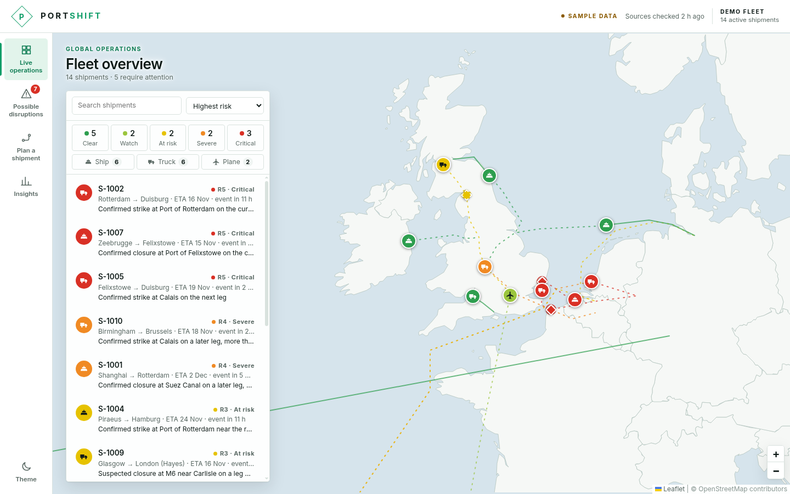
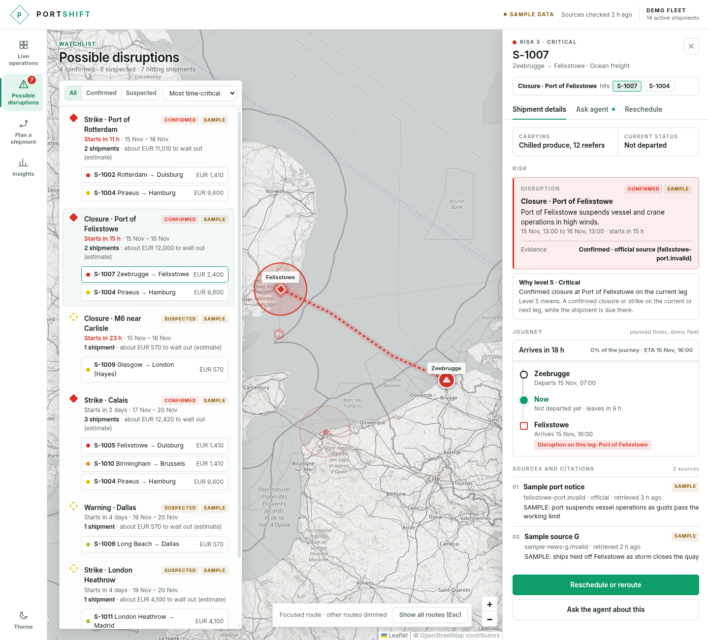
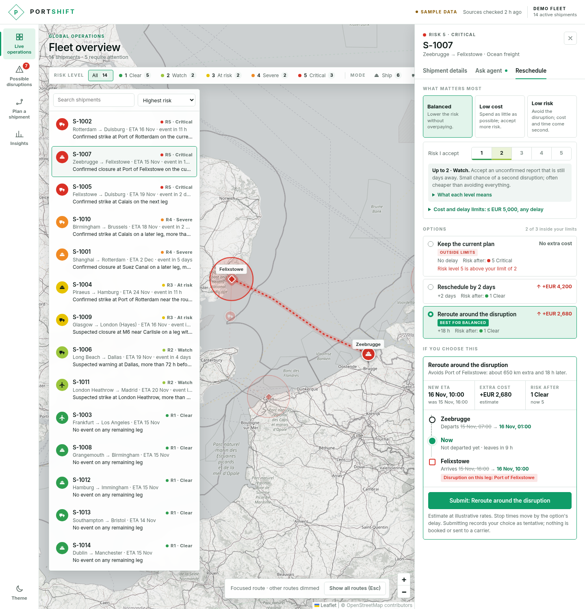
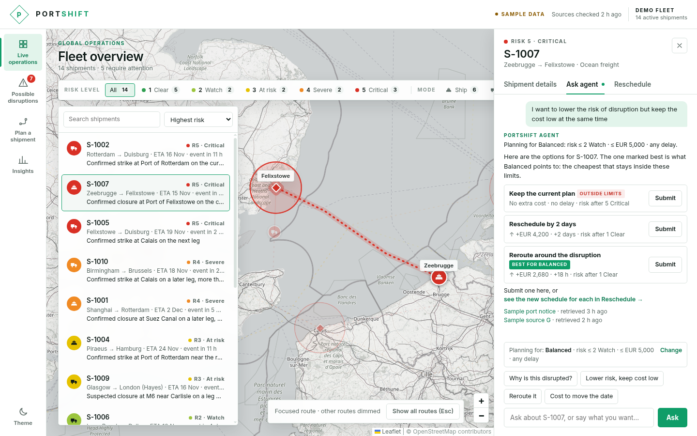
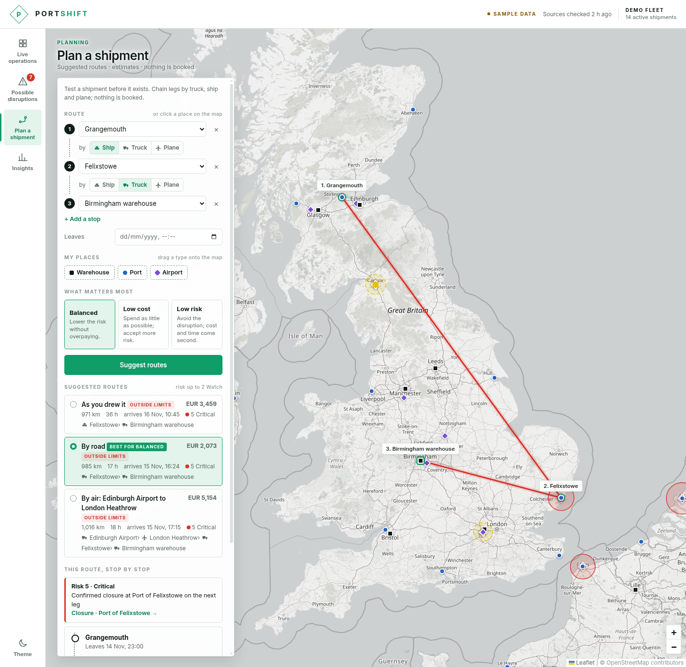

# PortShift

PortShift is an agent for the person in a logistics company whose job is to notice, before anyone else does, that
a port strike in Rotterdam is about to wreck three of their shipments. It reads live web news for strikes, closures
and warnings, works out which shipments are hit, scores each one from 1 (clear) to 5 (critical), and suggests what
to do about it, with a cost and a source link for every claim.

<table>
<tr>
<td align="center" valign="top"><br>The fleet on the map, coloured by risk.</td>
<td align="center" valign="top"><br>One shipment: route, reason, sources.</td>
<td align="center" valign="top"><br>Wait or reroute, each with a cost.</td>
</tr>
</table>

One thing up front, because it matters: **the fleet is fake and the disruptions are real.** We don't have a real
company's shipments, so the demo fleet is made up, but it sits on real ports, roads and airports, and the news it
reacts to comes from live web searches. Costs are estimates from illustrative rates, and the app says so wherever a
number appears.

We built it at the Imperial AI Hackathon for the Autonomous Agents track, with the Databricks, Linkup, Figma and
Adaption bounties in mind.

## What happens when it runs

The agent searches the web with Linkup for each shipping corridor it watches. A language model reads each result
and decides whether it describes a real disruption at a named place. Most results don't: a lot of what comes back
for "Rotterdam strike" is quarterly statistics, LinkedIn profiles and articles about something that ended last
month. When a result does describe one, the agent writes it down as an event with its source. An event counts as
"confirmed" when two different websites agree or one official source (a port authority, a government) says so;
otherwise it is "suspected".

Then a plain, deterministic risk job (no AI involved) checks every shipment's remaining route against those events
and gives it a level. In the app you see the fleet on a map in its risk colours. Click a shipment and you get its
route, cargo, why it has that level, the sources with how fresh they are, and the options: wait it out, or reroute,
each with an estimated cost. You can also ask PortShifter, the chat assistant, to explain things or plan new
shipments from a sentence.

The code is split the same way:

- `agent/` searches, extracts, cross-checks and writes events.
- `pipelines/` holds the Delta table definitions, the loaders and the risk job.
- `app/` is the web app: map, shipment panel, options, chat, Plan a shipment, Planned shipments, Fleet, Insights and
  My rates.
- `finetune/` and `evals/` hold the fine-tunes and how we measured them.

`AGENTS.md` has the risk rules and `CONTRACTS.md` has the tables and interfaces.

## The app

Screenshots of the running app on the demo fixtures: a made-up fleet and sample disruptions, marked "sample" on screen.
Every cost shown is an estimate at illustrative rates, and nothing is booked.

<table>
<tr>
<td align="center" valign="top"><br>Possible disruptions: what is coming, which shipments it hits, and what waiting would cost.</td>
<td align="center" valign="top"><br>Ask agent: "lower the risk but keep the cost low" becomes a setting and a set of options.</td>
</tr>
<tr>
<td align="center" valign="top"><br>Plan a shipment: suggested routes by road and ferry, sea and air.</td>
<td align="center" valign="top"><br>A ship leg chained with a truck leg, flagged by a closure on the way.</td>
</tr>
<tr>
<td align="center" valign="top"><br>Planned shipments: plans you kept, with status, cost, risk and stops.</td>
<td align="center" valign="top"><br>Fleet: the operator's own vehicles and depots.</td>
</tr>
<tr>
<td align="center" valign="top"><br>Truck routes follow real roads, here through the Channel Tunnel.</td>
<td align="center" valign="top"><br>Insights: fleet statistics.</td>
</tr>
<tr>
<td align="center" valign="top"><br>Dark theme, the look of the original Figma design.</td>
<td></td>
</tr>
</table>

More screens, and how the layout changed from one version to the next, are in `design/app/`.

## Databricks

Everything the app knows lives in Delta tables, 15 of them in `workspace.portshift` on a Free Edition workspace.
A Databricks Job, "PortShift: monitor -> risk", runs the agent's search step and then the risk job on serverless
compute, reading its credentials from a secret scope. The app itself is deployed as a Databricks App. Extraction
runs on Llama 3.3 70B through Databricks model serving.

The job's schedule is paused on purpose. Search credits are limited, so we run it when we want fresh data, and each
run stops after 12 Linkup calls (`pipelines/job_entry.py monitor --max-calls`).

## The fine-tunes

This is the part we learned the most from.

Our first extractor fine-tune (Adaption run `4c406bd7`) looked great on paper: a 0.942 win rate and near-perfect
scores on our held-out set. Then we pointed the agent at real search results and it kept turning state-aid
announcements and port statistics into "closures". The held-out set had been written from the same templates as
the training data, so it couldn't catch that.

So for v2 we built a test from real Linkup results instead, 138 of them labelled by hand. We used 72 to find
mistakes (the dev set). We labelled the other 50 before any model saw them and kept them for the final number (the
test set). The training data stayed synthetic, but this time it was shaped like real search results, and about half
of it is the kind of thing that should *not* be extracted. On the test set, detection F1 came out like this:

| Extractor | F1 | Precision | Recall |
|---|---|---|---|
| Qwen3.5-2B, untuned, same prompt | 0.361 | 0.220 | 1.000 |
| Qwen3.5-2B fine-tuned on Adaption (run B, `11efbc11`) | 0.857 | 0.900 | 0.818 |
| Llama 3.3 70B on Databricks, strict prompt | 0.870 | 0.833 | 0.909 |

The untuned 2B model calls almost everything a disruption. After fine-tuning, it gets within about a point of a 70B
model and raises fewer false alarms. The biggest single gain came from having Llama reword the training examples in
different styles, with checks that every place, date and label survived. Run A, the same examples without the
rewording, only reached 0.733.

We still use Llama 70B in the live path, because it misses fewer real events, and a missed strike costs more than an
extra alert. Adaption's win rates are its own judged preference scores, not accuracy, so we don't quote them as
accuracy. Everything above, plus the v1 run and what went wrong along the way, is in `finetune/RESULTS.md`.

There's a second fine-tune, the request reader for PortShifter (run `34e00a06`). On its own it's worse than our
fixed patterns, but it's much better at splitting "send X to Y and then Z" into separate shipments, so the app uses
it for exactly that and nothing else. Same file, second section.

## Checking the citations

`evals/check_citations.py` checks that every claim has a complete citation, that URLs resolve (with `--online`),
that freshness is shown, and that every "confirmed" event really has two domains or an official source. The
hand-labelled search results, the scorer and the runner are in `finetune/real/`. We committed our labels but not the
news text itself, since that isn't ours to publish. `collect.py` and `collect_test.py` fetch it again.

## Running it

```bash
cd app && pip install -r requirements.txt && uvicorn main:app --port 8000
```

That runs on the bundled sample data, no keys needed. To use live search, Databricks or the models, put keys in a
local `.env` (the names are in `.env.example`, and keys never go in the repo). With `DATABRICKS_*` set, the app reads
the Delta tables instead of the sample files.

```bash
python3 evals/check_citations.py            # citation checks
python3 finetune/real/score.py --test FILE  # score extractor predictions on the real test set
```

## What we used

| Service or model | What for | State on 15 Nov |
|---|---|---|
| Linkup search | Every live disruption and its citation | Live |
| Databricks Delta, SQL warehouse, Jobs, Apps, model serving | State, the monitor and risk job, hosting, extraction with Llama 3.3 70B | Live |
| Adaption AutoScientist | Extractor fine-tunes (v1, v2 runs A to C) and the request reader | Live, run ids in `finetune/RESULTS.md` |
| OSRM demo router | Real road routes for the demo trucks, fetched once (`pipelines/road_geometry.py`) | Stored in `demo/fixtures/legs.json` |
| Figma and the Figma MCP server | Designing the UI first; frames are in `design/` | Used in design |
| OpenStreetMap and Leaflet 1.9.4 | The map | Live in the browser |

On data: the demo fleet in `demo/fixtures/` is synthetic and sample events use `.invalid` links and a "sample"
badge. The fine-tune training data is generated, with exact labels. The only real-world data are the live search
results and our hand labels for them. Default rates are illustrative, and market rates carry a source on each line.
No real fleet or customer data is used anywhere.
